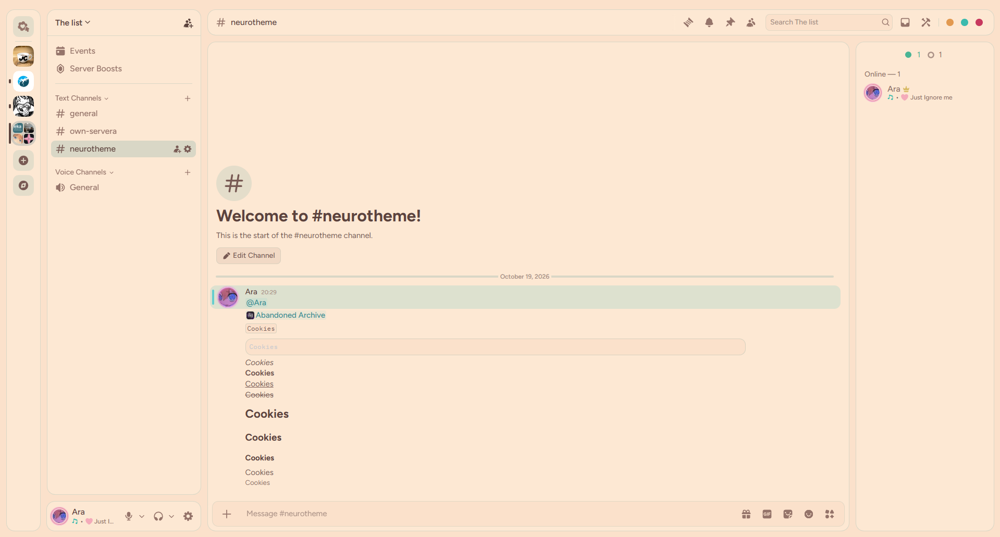
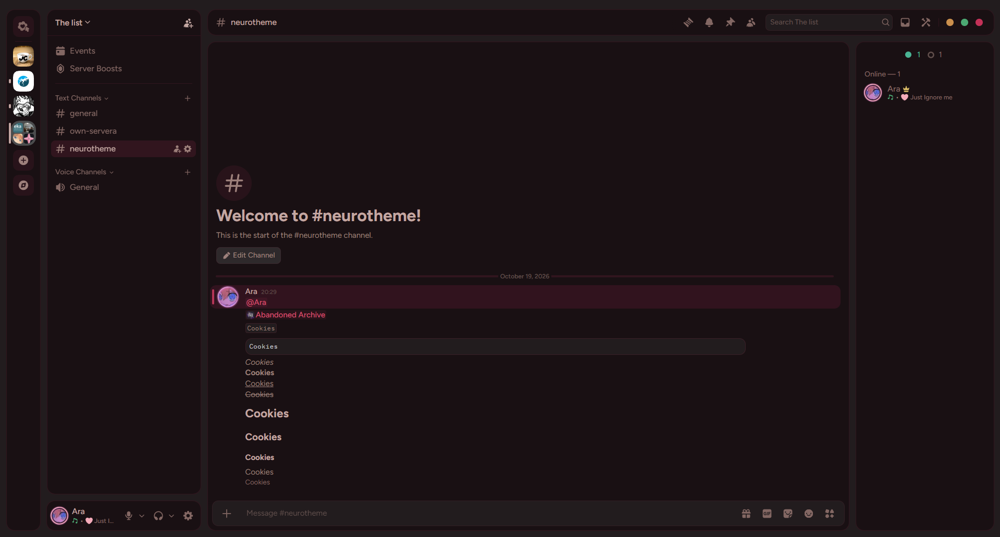
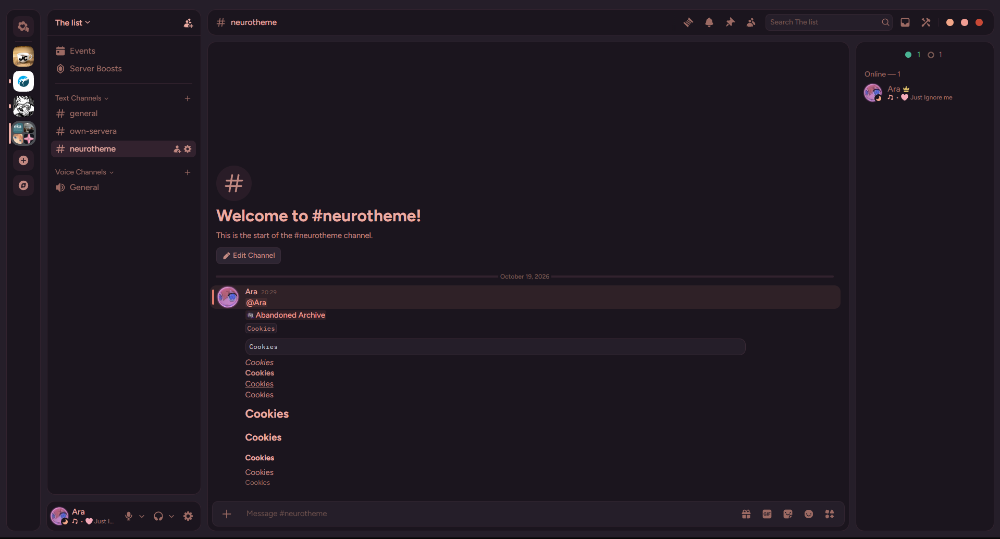

# Neuro Theme for Discord

A set of **Neuro-sama inspired** Discord themes for [BetterDiscord](https://betterdiscord.app/), built on top of [refact0r's Midnight](https://github.com/refact0r/midnight-discord).

Three flavors are included — pick your vibe:

| Theme | Mode | Palette |
| --- | --- | --- |
| **New-Neuro-LightMode** | Light | Warm cream + mint-teal |
| **New-Evil-DarkMode** | Dark | Charcoal + blood-red |
| **Old-Neuro-Dark** | Dark | Salmon on plum |

The two **New** themes also bundle [RadialStatus](https://github.com/DiscordStyles/RadialStatus), wrapping the status indicator around avatars.

---

## 🎨 Themes & Previews

### New-Neuro-LightMode



```
https://raw.githubusercontent.com/ArmaLv/Neuro-Theme/refs/heads/main/New-Neuro-LightMode.css
```

### New-Evil-DarkMode



```
https://raw.githubusercontent.com/ArmaLv/Neuro-Theme/refs/heads/main/New-Evil-DarkMode.css
```

### Old-Neuro-Dark



```
https://raw.githubusercontent.com/ArmaLv/Neuro-Theme/refs/heads/main/Old-Neuro-Dark.css
```

---

## 📦 Installation

1. Install [BetterDiscord](https://betterdiscord.app/).
2. Open **Discord → Settings → Themes** and click **Open Themes Folder**.
3. Download the `.css` of the theme you want (use the quick-copy link above, or grab the file from this repo) and drop it into that folder.
4. Enable the theme in the Themes list.

Everything is customizable from the top of each `.css` file — colors, gaps, the top bar, window controls, the DMs icon, blur, and more.

---

## 🙏 Credits

- [Midnight](https://github.com/refact0r/midnight-discord) by **refact0r** — the base this theme is built on.
- [RadialStatus](https://github.com/DiscordStyles/RadialStatus) by **Gibbu / DiscordStyles** — radial status indicators.
